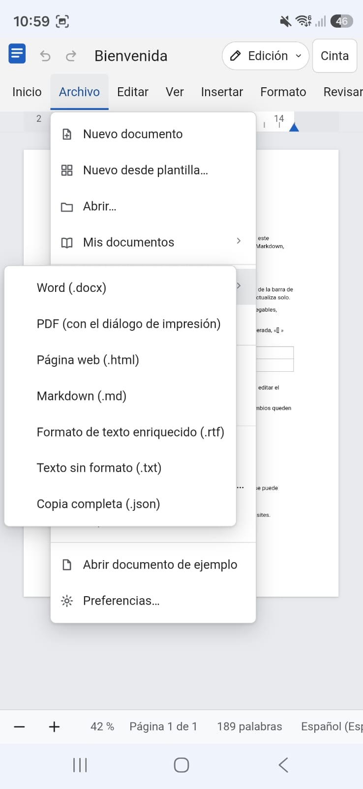
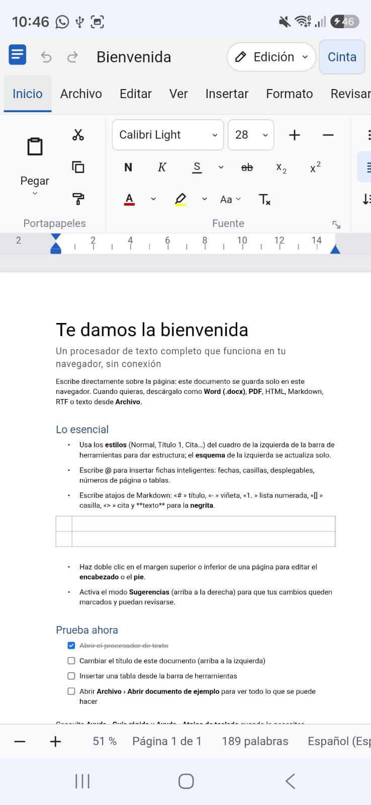
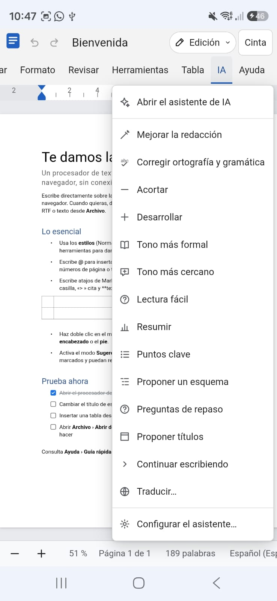
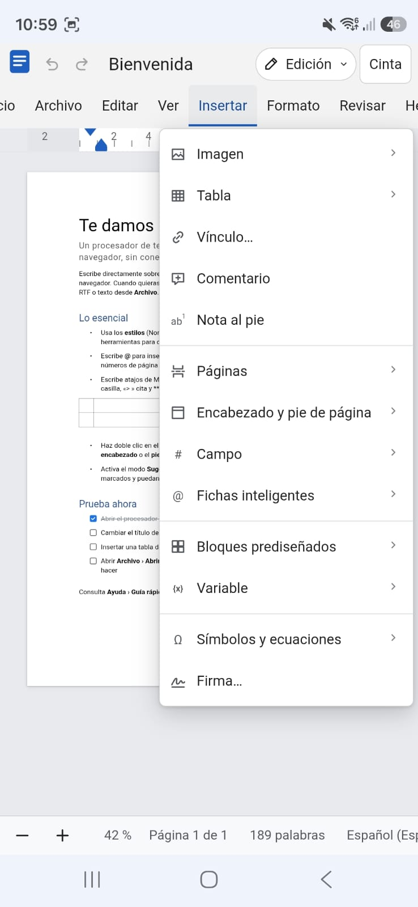
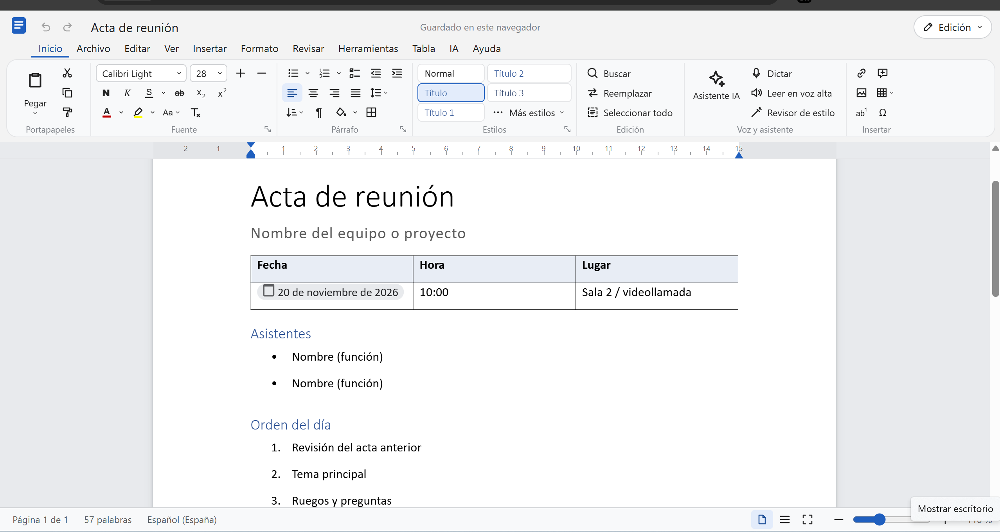
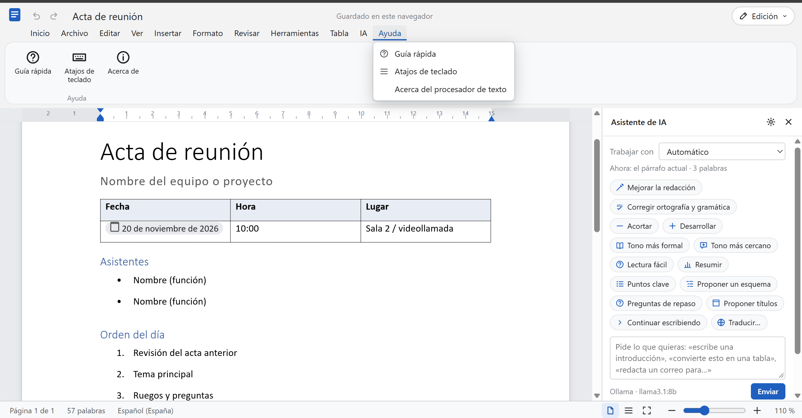
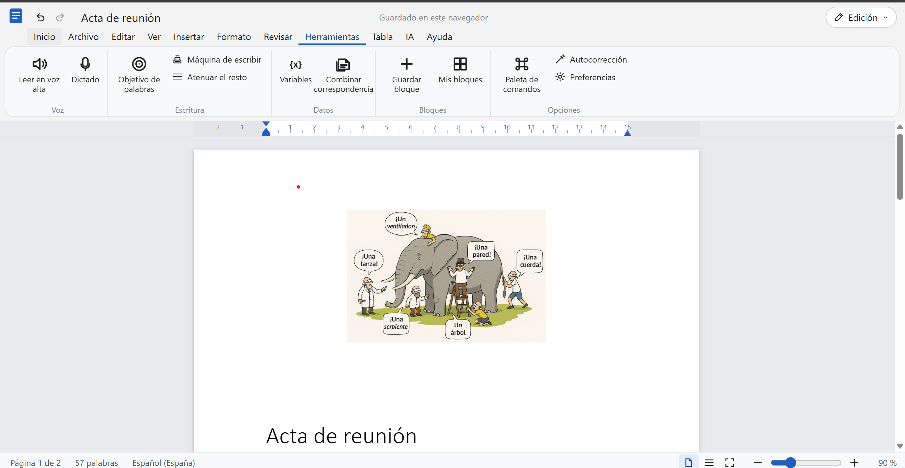

# Procesador de texto

Procesador de texto en español para el navegador. Funciona sin conexión y sin instalar nada: HTML, CSS y
JavaScript puro, con las mismas técnicas que la hoja de cálculo de la carpeta `hoja de calculo`.

## Pantallazos de Android

| Menú Archivo (exportar) | Cinta Inicio | Menú IA | Menú Insertar |
| --- | --- | --- | --- |
|  |  |  |  |

## Pantallazos de la versión web







## Cómo abrirlo

Doble clic en `index.html` (Chrome, Edge o Firefox recientes). El documento se guarda solo en el navegador
y aparece en **Archivo › Mis documentos**. Para llevarlo a otro equipo o conservarlo, usa **Archivo ›
Descargar como**. **Archivo › Abrir documento de ejemplo** carga un informe que reúne casi todas las funciones.

También se puede servir la carpeta con cualquier servidor estático, por ejemplo:

```powershell
python -m http.server 8766 --bind 127.0.0.1
```

## Qué incluye

- **Menús con cinta de botones**: cada menú (Archivo, Editar, Ver, Insertar, Formato, Revisar, Herramientas, Tabla,
  IA, Ayuda) tiene su cinta con todas sus opciones como botones agrupados por tema, como las pestañas de Word. Basta
  con **pasar el puntero** por el nombre de un menú para ver sus botones; con un **clic** se despliega además su lista.
  Los menús largos usan filas más compactas y siempre se abren debajo de la barra (con barra de desplazamiento si no
  caben), así que nunca la tapan. Los botones muestran si están activos (negrita, alineación, regla…) y se desactivan
  cuando no se pueden usar; la flecha de la esquina de un grupo abre su cuadro de diálogo. Si la ventana es estrecha,
  los grupos menos usados se recogen en un botón con su menú; en el móvil la cinta se desplaza con el dedo.
- **Inicio** reúne lo más usado, como la pestaña Inicio de Word: **Portapapeles** (Pegar con sus opciones, Cortar,
  Copiar, Copiar formato), **Fuente** (fuente, tamaño, negrita, cursiva, subrayado con estilos, tachado, subíndice,
  superíndice, colores, mayúsculas y minúsculas, borrar formato), **Párrafo** (viñetas, numeración, casillas,
  sangrías, alineación, interlineado, **ordenar** párrafos de la A a la Z, mostrar ¶, **sombreado** y bordes),
  **Estilos**, **Edición** (buscar, reemplazar, seleccionar todo), **Voz y asistente** (asistente de IA, dictar,
  leer en voz alta, revisor de estilo) e **Insertar** (vínculo, comentario, imagen, tabla, nota y símbolo).
  **Deshacer** y **Rehacer** están siempre en la barra de título.
- **Páginas reales**: tamaño de papel (A4, Carta, Oficio, A5, A3…), orientación, márgenes con valores
  predefinidos, encabezado y pie (con primera página diferente), números de página, color de página y marca de
  agua. El texto se reparte en páginas mientras escribes, con saltos de página, control de líneas viudas y
  huérfanas, títulos que no se quedan solos al pie y tablas que continúan en la página siguiente repitiendo la
  fila de encabezado. También hay un modo **sin páginas**.
- **Formato de carácter**: fuente, tamaño, negrita, cursiva, subrayado (sencillo, doble, punteado, ondulado…),
  tachado, superíndice, subíndice, versalitas, mayúsculas, espaciado, color y resaltado. **Copiar formato**,
  **Borrar formato** y **Mayúsculas y minúsculas** (oración, título, inverso…).
- **Párrafos**: estilos con nombre (Normal, Título, Subtítulo, Título 1–6, Cita, Código, Descripción…) que se
  pueden modificar, crear y actualizar desde la selección; alineación, sangrías (también arrastrando en la regla),
  sangría francesa, espaciado antes y después, interlineado, conservar con el siguiente, letra capital, bordes y
  sombreado.
- **Listas**: viñetas de varios tipos, números, letras, romanos, esquema (1. 1.1. 1.1.1.) y listas de
  verificación con casillas; niveles con Tab, reiniciar, continuar y empezar en un número.
- **Insertar**: imágenes (desde el equipo, una dirección web, arrastrando o pegando) con cambio de tamaño y ajuste
  del texto; tablas con combinar y dividir celdas, filas y columnas, anchos arrastrables, color de celda,
  alineación vertical, bordes y ordenación; vínculos (también a títulos del documento); notas al pie; índice
  automático con números de página; salto de página; línea horizontal; símbolos y emoji; ecuaciones (notación
  LaTeX mostrada con MathML); campos (página, total de páginas, fecha, título, autor, palabras) y **fichas
  inteligentes**: fecha, casilla y desplegables de estado o prioridad. Escribe **@** para el menú de inserción
  rápida y **:palabra** para emoji.
- **Revisión**: comentarios con respuestas, resolver y reabrir; **control de cambios** (modo Sugerencias) con
  aceptar y rechazar uno a uno o todos; recuento de palabras con tiempo de lectura e índice de legibilidad
  Fernández Huerta; ortografía del navegador con idioma por documento; lectura en voz alta y dictado.
- **Edición**: deshacer y rehacer agrupando lo escrito por palabras; buscar y reemplazar con mayúsculas, palabra
  completa, tildes y expresiones regulares (todas las coincidencias se resaltan); ir a página o título; pegar
  desde Word, Google Docs o páginas web conservando el formato; pegar sin formato y pegar Markdown.
- **Formato automático**: atajos de Markdown (`# `, `- `, `1. `, `[] `, `> `, `**negrita**`, `*cursiva*`,
  `` `código` ``, `---`), comillas tipográficas o angulares, mayúscula al empezar una oración y reemplazos como
  (c) → ©, -- → —, ... → … (se deshacen con Ctrl+Z).
- **Vista**: regla, esquema del documento, caracteres de formato, zoom (también ajustar al ancho o página
  completa), modo enfoque, modo lectura, pantalla completa y tema oscuro.
- **Archivos**: guardado automático, biblioteca de documentos, historial de versiones con nombre (y automáticas),
  plantillas (carta, currículum, informe, acta, trabajo académico, plan de proyecto, apuntes) e impresión o PDF
  con exactamente las mismas páginas que en pantalla.

| Formato | Abrir | Guardar |
| --- | --- | --- |
| Word (.docx) | Sí: estilos, fuentes del tema, listas, tablas combinadas, imágenes, vínculos, notas, comentarios, cambios controlados, encabezados, pies, campos, índice, variables del documento y números de línea | Sí, lo mismo |
| PDF | No | Con el diálogo de impresión («Guardar como PDF») |
| Página web (.html) | Sí | Sí |
| Markdown (.md) | Sí (también tablas, casillas y notas) | Sí |
| RTF | Sí (texto y formato básico) | Sí |
| Texto (.txt) | Sí | Sí |
| Copia completa (.json) | Sí | Sí |

Los archivos .docx que genera se comprobaron abriéndolos con Microsoft Word, y los creados con Word se abren aquí
y se pueden volver a guardar sin perder estilos, listas, tablas, notas, comentarios ni cambios.

## Funciones novedosas

Inspiradas en lo que han traído en 2026 Word (Copilot), Google Docs (Gemini) y las aplicaciones de escritura
(iA Writer, Ulysses…), y en lo que todavía no tiene ninguno. Están en los menús **Revisar** e **IA** y en
**Herramientas**, **Insertar** y **Ver**.

- **Asistente de IA** (menú **IA**). Mejora la redacción, corrige, acorta, desarrolla, cambia el tono, pasa a
  lectura fácil, traduce, resume, saca los puntos clave, propone un esquema, títulos o preguntas de repaso y continúa
  escribiendo; también acepta peticiones libres. La respuesta llega en directo y se puede **reemplazar**,
  **insertar** o aplicar **como sugerencia**: entonces queda como cambio controlado de «Asistente IA» y, como en
  Word, marcado **palabra a palabra**, para aceptarlo o rechazarlo cambio a cambio. Funciona con:
  - **Claude** (Anthropic) con tu propia clave de API: se usa Claude Opus 5.5 por omisión (se puede elegir Sonnet,
    Haiku o Fable) con pensamiento adaptativo y, si un modelo rechaza la petición, respaldo automático con otro.
  - **Ollama**, un modelo local **sin internet**: la configuración lista los modelos instalados (por ejemplo
    `llama3.1:8b` o `qwen2.5:7b`). Si abres el procesador con doble clic, Ollama solo acepta la conexión si defines
    la variable `OLLAMA_ORIGINS` con el valor `*` (en Windows: `setx OLLAMA_ORIGINS *` y reiniciar Ollama).
  - **Otros proveedores** con la API compatible con la de OpenAI, cada uno con su clave y su modelo: **OpenAI**
    (ChatGPT), **Google Gemini**, **Mistral AI**, **DeepSeek**, **Groq**, **OpenRouter** (cientos de modelos),
    **xAI** (Grok), **Together AI**, **Perplexity**, **LM Studio** (local) u **otro servicio** indicando su dirección.
    El botón «Buscar modelos disponibles» lista los modelos de tu cuenta. Se comprobó que todos estos servicios
    aceptan las llamadas directas desde el navegador, también con el procesador abierto con doble clic.

  El documento no sale del equipo hasta que pides algo al asistente, y entonces solo se envía el texto con el que
  trabaja (las imágenes van como «[Imagen: descripción]»).
- **Autoría del texto**. Distingue lo que escribes tú, lo que **pegas** de fuera y lo que propone la **IA**
  (**Ver › Autoría del texto** lo resalta en naranja y violeta; **Revisar › Autoría del texto** da los porcentajes).
  Lo que escribes dentro de un texto pegado cuenta como tuyo. Útil en clase para ver de un vistazo qué es propio.
- **Revisor de estilo en español, sin conexión** (**Revisar › Revisor de estilo**). Resalta en el texto, por
  colores, las oraciones largas y muy largas, la voz pasiva, los adverbios en *-mente*, las palabras repetidas cerca,
  expresiones mejorables o desaconsejadas (*en base a*, *a nivel de*, *subir arriba*, muletillas…), dequeísmo y
  queísmo, formas como *dijistes* o *habían muchas*, signos de apertura que faltan (¿ ¡) y espacios. Da el índice de
  legibilidad y corrige con un clic una sugerencia o todas las de un tipo.
- **Comprobador de accesibilidad** (**Revisar › Accesibilidad**): imágenes sin texto alternativo (que la IA puede
  describir), saltos de nivel en los títulos, tablas sin fila de encabezado, poco contraste, vínculos del tipo
  «aquí», texto muy pequeño o en mayúsculas, párrafos vacíos para separar… con arreglo directo cuando es posible.
- **Comparar documentos** (**Revisar › Comparar documentos**) con una versión guardada o con otro archivo (.docx,
  .md, .html…): se abre un documento con las diferencias como cambios controlados, palabra a palabra.
- **Pegar para vincular**: si pegas una dirección web con un texto seleccionado, el texto se convierte en vínculo.
- **Números de línea** (**Formato › Números de línea**): continuos, por página o cada 5 líneas, en pantalla, al
  imprimir y en Word.
- **Paleta de comandos** (**Ctrl+Mayús+P** o **Alt+/**): escribe lo que quieres hacer y se ejecuta.
- **Escritura enfocada** (**Ver**): modo máquina de escribir (la línea actual siempre en el centro) y atenuar todo
  menos el párrafo en el que escribes. **Objetivo de palabras** con fecha límite y progreso en la barra de estado.
- **Bloques prediseñados** (**Insertar › Bloques** o escribiendo **@**): notas de reunión, plan de clase, rúbrica
  de evaluación, lista de tareas, hoja de ruta, borrador de correo, pros y contras, registro de decisiones, ficha de
  lectura y cuadros de nota, advertencia e importante. Con **Mis bloques** guardas cualquier selección para reutilizarla.
- **Variables y combinación de correspondencia** (**Insertar › Variable**, **Herramientas**): un dato (nombre,
  curso, cliente…) se escribe una vez y se actualiza en todo el documento. Con **Combinar correspondencia** se pegan
  los datos de una hoja de cálculo o se abre un CSV y se crea una copia por fila, en un solo documento (una por
  página) o en un .zip con un Word por registro.
- **Modo presentación** (**Ver › Modo presentación**): el documento se convierte en diapositivas, una por cada
  título, con el texto ampliado para proyectar.
- **Dibujo a mano y firma** (**Insertar**): con el ratón, el dedo o un lápiz (con presión); la firma puede llevar
  debajo el nombre y la fecha.

## Atajos principales

| Atajo | Acción |
| --- | --- |
| Ctrl+B, I, U | Negrita, cursiva, subrayado |
| Ctrl+Alt+1…6 / Ctrl+Alt+0 | Título 1 a 6 / texto normal |
| Ctrl+Mayús+7, 8, 9 | Lista numerada, con viñetas, de verificación |
| Ctrl+Mayús+L, E, R, J | Alinear a la izquierda, centrar, a la derecha, justificar |
| Ctrl+K / Ctrl+Alt+M / Ctrl+Alt+F | Vínculo / comentario / nota al pie |
| Ctrl+Intro / Mayús+Intro | Salto de página / salto de línea |
| Ctrl+F / Ctrl+H / Ctrl+G | Buscar / reemplazar / ir a |
| Ctrl+S / Ctrl+P | Descargar como Word / imprimir o PDF |
| Ctrl+Mayús+P o Alt+/ | Paleta de comandos |
| @ | Menú de inserción rápida (fichas, bloques, variables, IA, firma…) |

**Ayuda › Atajos de teclado** muestra la lista completa. Con **Ctrl + clic derecho** aparece el menú del
navegador con las sugerencias de ortografía.

## Cómo está hecho

### La hoja de cálculo que sirve de referencia (versión web)

| Aspecto | Hoja de cálculo | Procesador de texto |
| --- | --- | --- |
| Arranque | `index.html` con `css/app.css` y scripts clásicos en orden, sin módulos ni compilación; abre con doble clic | Igual: 22 scripts clásicos bajo el espacio de nombres `PT` (allí `HC`) |
| Motor | `js/core`, `js/formula`, `js/model`: celdas, fórmulas, transacciones `begin/commit`, deshacer y rehacer | `js/core`, `js/model`: documento, tramos con marcas internadas, pasos reversibles, transacciones y deshacer agrupado |
| Interfaz | `js/ui`: `h()` para crear elementos, iconos SVG de 16×16, menús, diálogos, avisos y selector de color; cuadrícula en Canvas | `js/ui/dom.js` adapta esas mismas utilidades; la página es un flujo editable del DOM (para conservar el corrector ortográfico, el IME y la accesibilidad) |
| Archivos | ZIP propio con `CompressionStream`, XML de Office escrito a mano | Igual para .docx, más un analizador XML propio para poder leerlos también en Node |
| Guardado | JSON en `localStorage` con un retraso de 1,2 s | JSON en IndexedDB (con respaldo en `localStorage`), biblioteca y versiones |
| Estilos | Variables CSS, tema oscuro con `data-theme`, fuentes del sistema, adaptación a pantallas táctiles | Igual, con acento azul |
| Pruebas | `node tests/run.js` carga el motor sin interfaz | Igual |

### La carpeta `procesador de texto` (Folio)

Folio guarda el documento como HTML dentro de un `contenteditable` y aplica el formato sobre el propio DOM. Sirvió
como lista de funciones, pero no se reutilizó su código: para un procesador robusto hace falta un modelo propio
(como el libro de la hoja de cálculo) con deshacer fiable, páginas reales y conversión exacta a Word.

### Arquitectura del procesador

```
index.html
css/app.css            interfaz (barras, menús, diálogos, paneles, tema oscuro)
js/core/base.js        espacio de nombres PT, unidades, colores, papel, fuentes, fechas
js/model/doc.js        documento: marcas, tramos, párrafos, tablas, estilos, listas, historias, índice de
                       posiciones, pasos reversibles, transacciones, deshacer/rehacer, JSON
js/model/ops.js        operaciones: escribir, borrar (también entre tablas), dividir y unir párrafos, marcas,
                       estilos, listas, tablas, notas, comentarios, control de cambios, copiar/pegar, buscar…
js/model/compare.js    comparar documentos: alineación de párrafos y diferencias palabra a palabra
js/view/render.js      del modelo al DOM y traducción de posiciones DOM <-> modelo
js/view/layout.js      paginación, hojas, encabezados, pies, notas al pie y marca de agua
js/view/doccss.js      estilos del documento (pantalla, impresión y copia)
js/ui/editor.js        entrada (beforeinput, IME y teclas muertas), selección, portapapeles, arrastrar,
                       formato automático, imágenes y columnas de tablas
js/ui/app.js           controlador: refresco, comandos, zoom, encabezados y notas, menú @
js/ui/chrome.js        menús, barra de herramientas, regla, esquema, comentarios, cambios, estado
js/ui/ribbon.js        cinta: los botones de cada menú agrupados, con estados y plegado de grupos
js/ui/dialogs.js       buscar, vínculo, párrafo, fuente, página, numeración, estilos, tablas, imágenes…
js/ui/tools.js         símbolos, ecuaciones, recuento, preferencias, versiones, plantillas, voz
js/ui/review.js        revisor de estilo, accesibilidad, comparar documentos y autoría del texto
js/ui/assist.js        asistente de IA (API de Claude con streaming u Ollama) y sugerencias palabra a palabra
js/ui/extras.js        paleta de comandos, escritura enfocada, objetivo de palabras, números de línea, bloques,
                       variables y combinación de correspondencia, modo presentación, dibujo y firma
js/io/zip.js, xml.js   ZIP y XML propios
js/io/docx.js          lectura y escritura de Word
js/io/convert.js       HTML, Markdown, RTF, texto y portapapeles
js/io/files.js         guardado, biblioteca, versiones, abrir, descargar, imprimir, plantillas
tests/                 pruebas del motor y de los formatos
```

El documento nunca se edita directamente en el DOM: cada pulsación se convierte en una operación del modelo y la
vista solo vuelve a dibujar el párrafo afectado. La paginación inserta espaciadores no editables donde termina
cada página (entre bloques, al principio de la línea que no cabe o entre filas de una tabla) y dibuja las hojas
detrás. Solo se repagina cuando un cambio altera el alto de algo, de modo que escribir sigue siendo rápido en
documentos largos (unos 15 ms por pulsación en un documento de 86 páginas).

## Límites conocidos

- No hay columnas de texto ni secciones con orientación o encabezados distintos dentro del mismo documento
  (al abrir un .docx con varias secciones se usa la configuración de la última y los cambios de sección pasan a
  ser saltos de página). Los encabezados de páginas pares e impares no se distinguen.
- No hay cuadros de texto, formas ni gráficos de Office: al abrir un .docx se avisa de cuántos objetos no se
  pudieron importar. Las imágenes EMF/WMF no se pueden mostrar en el navegador.
- No abre los formatos antiguos .doc ni .odt (guárdalos antes como .docx).
- En Word las ecuaciones se guardan como texto, y las respuestas a comentarios como párrafos del comentario.
- El control de cambios marca lo escrito y lo borrado dentro de los párrafos; unir o dividir párrafos no queda
  registrado como cambio.
- La ortografía depende del corrector del navegador y de los diccionarios que tenga instalados. El dictado usa
  el reconocimiento de voz del navegador, que en Chrome necesita conexión.
- Sin conexión a internet solo se usan las fuentes instaladas en el equipo.
- El asistente de IA necesita una clave de API de Anthropic o un modelo de Ollama en el equipo. La calidad de las
  respuestas depende del modelo: los locales pequeños aciertan menos, por eso conviene aplicar sus propuestas como
  sugerencias y revisarlas.
- El revisor de estilo se basa en reglas: puede señalar casos correctos (por ejemplo, un participio que es adjetivo)
  y no sustituye a una revisión humana. Solo revisa el cuerpo del documento.
- La comparación de documentos tiene en cuenta el cuerpo (no los encabezados, pies ni notas) y no marca los cambios
  que son solo de formato.

## Pruebas

```powershell
node tests/run.js
```

Comprueban el modelo, las operaciones de edición (incluido borrar a través de tablas y el control de cambios),
las tablas, las listas, el deshacer, la ida y vuelta con Word, Markdown y texto, la autoría del texto, las variables,
los números de línea y la comparación de documentos (110 pruebas).
